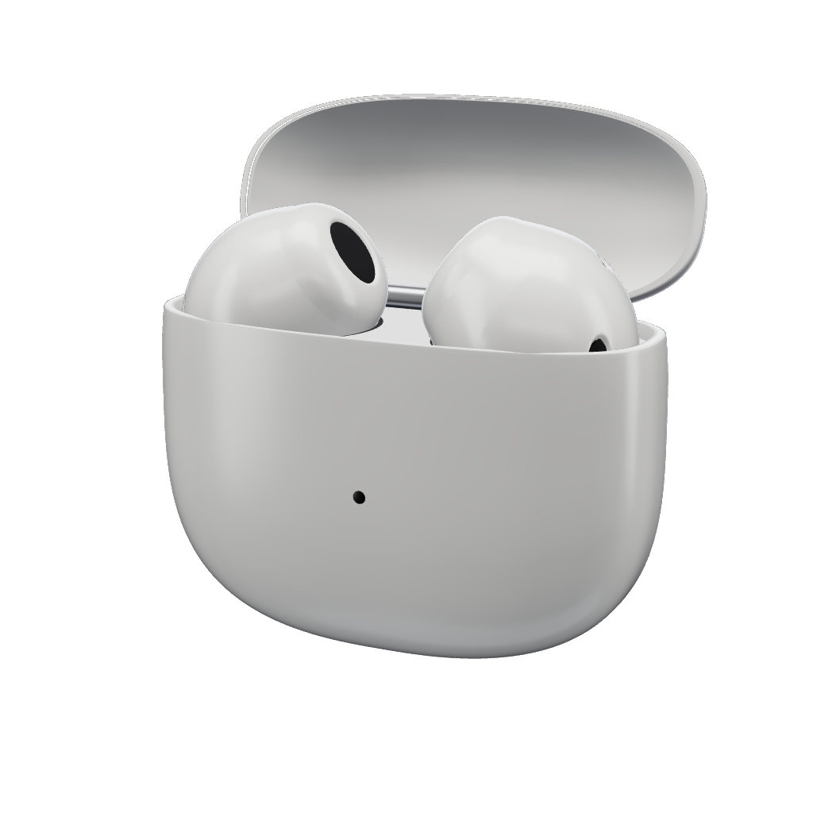

<p align="center">
  
</p>

<h1 align="center">PodMouse</h1>

<p align="center">
  <b>Your AirPods case is a mouse.</b><br>
  Open it, aim it, tap to click. Or go hands-free and point with your head.
</p>

<p align="center">
  <a href="https://github.com/0xCodez/PodMouse/releases/latest/download/PodMouse.zip"><b>Download for Mac</b></a>
</p>

## What it does

PodMouse is a native menu bar app that reads the motion sensors inside AirPods and turns them into a smooth pointer. There's no extra hardware, no camera, and no network.

| Case in hand | |
|---|---|
| Aim the case | Moves the pointer |
| Pause, then tap the case | Click |
| Twist right and back | Right click |
| Twist left and back | Start or finish a drag (off by default) |

**Hold it like a laser pointer.** Rest your elbow and move only your wrist, in short smooth moves. Stop before you tap: taps only count on a still hand. If it feels off after you change your grip, recalibrate: calibration learns the axes of your wrist.

| In your ears | |
|---|---|
| Turn your head | Moves the pointer |
| Nod, or press the stem | Click |
| Press the stem twice | Right click |
| Shake your head, or press three times | Pause |

Shortcuts: **⌃⌥T** pause, **⌃⌥C** center the pointer. You can also turn on clicking by resting on a button.

## Requirements

- macOS 15 or later
- AirPods with head tracking. Tested with AirPods 4; AirPods (3rd generation), AirPods Pro, AirPods Max, and Beats Fit Pro should work but are untested.
- For case mode: the lid open, and **Automatic Ear Detection** turned off in your AirPods settings. With it on, AirPods stop sending motion as soon as they leave your ears. Closing the lid disconnects them either way.

## Install

1. Download `PodMouse.zip`, unzip it, and move PodMouse to Applications.
2. Open it. If macOS can't verify the developer, go to **System Settings › Privacy & Security** and choose **Open Anyway**.
3. Allow Accessibility and Motion, turn off Automatic Ear Detection for case mode, then follow the three calibration moves in the notch.

### Build from source

```bash
git clone https://github.com/0xCodez/PodMouse.git
cd PodMouse
make install
```

Building needs Xcode 16 or later. `make test` runs the unit tests.

## Permissions and privacy

| Permission | Why |
|---|---|
| Accessibility | To move the pointer and click |
| Motion | To read the AirPods' sensors |

Motion is processed in memory and thrown away. PodMouse makes no network requests and has no analytics.

## Troubleshooting

**The pointer doesn't move.** AirPods send motion only to the device they're playing for. Choose them under **Control Center › Sound**, or use the button in the PodMouse menu.

**Nothing happens with the case in hand.** Check that the lid is open and Automatic Ear Detection is off (**System Settings ›** your AirPods). Then run the sensor check below to see what your pair sends.

**Check what the sensors send.** With the app built, this prints live readings for 20 seconds. Launch it with `open`: macOS stops the app if its binary is run directly, because the Motion permission belongs to the app.

```bash
open -W --stdout "$(tty)" --stderr "$(tty)" build/PodMouse.app --args --probe
```

**Tapping doesn't click.** Lower **Tap strength** in the menu. The bar under the slider shows how hard your last tap registered.

**The pointer doesn't move after an update.** macOS ties Accessibility to the exact build. Switch PodMouse off and on again in **System Settings › Privacy & Security › Accessibility**.

## How it works

```
CMHeadphoneMotionManager (rotation, gravity, acceleration at about 50 Hz)
  → AxisCalibration   splits rotation into your wrist's own two axes
  → PointerMapper     per-axis dead zone and bounded acceleration, as in AirCursor
  → PointerSmoother   eases to 120 Hz, stops when samples go stale
  → PointerOutput     CGEvent moves and clicks
GestureDetector       taps and twists, or nods and shakes
```

AirPods can sit in any orientation inside a case, and wrists don't rotate around tidy axes: in recordings, side-to-side and up-down were not perpendicular and followed neither gravity nor each other. So both axes are measured from sweeps, and rotation is decomposed without assuming they're perpendicular. `Tests/PodMouseCoreTests/Fixtures` holds a real recording that the tests replay.

The website lives in [`site/`](site). The earbuds and case are an original 3D model, baked from signed distance fields by `site/scripts/bake-bud.mjs`, and every image in the app is rendered from it.

## Acknowledgements

The pointer mapping is based on [AirCursor](https://github.com/m-afham/AirCursor) (MIT), and the silent-audio and Now Playing techniques were learned from it. See [NOTICE](NOTICE).

## Legal

PodMouse is an independent project, not affiliated with or endorsed by Apple Inc. AirPods, Beats, Mac, and macOS are trademarks of Apple Inc.

Released under the [MIT License](LICENSE).
